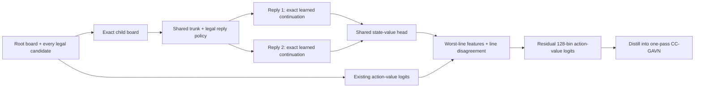

# CC-GAVN-R: counterfactual refutation and iterative distillation

Updated 2026-10-19. **Implementation written; no new training run or benchmark
result measured.** User confirmed: strictly below 5M parameters; learned
internal planning allowed; no external engine at inference. Historical runs,
checkpoints, and the active training recipe remain separate.

## 1. Decision

Build a compact model that can evaluate a move by following its strongest
predicted refutations. Train it on oracle-labeled alternatives and then on its
own predicted futures. Finally compress that ability back into a one-pass
model. This is a mechanism intervention rather than another long continuation
of the same teacher-output loss.

Why it could beat the 9M teacher: training adds information absent from that
teacher's predictions—direct engine analysis of counterfactual actions and
future states. The teacher's mistakes therefore need not define the ceiling.
However, fixed-node Stockfish labels must first be shown better than the
existing targets on independent positions; a bigger-looking budget alone is
not proof of stronger labels.

## 2. Architecture and parameter budget

For every legal root candidate, apply the move exactly, predict two legal
opponent replies, and follow each line with the learned policy. The default
horizon is four future boards (after root move, reply, our continuation, next
reply). All neural calls share the existing eight-layer, width-208 trunk.



There is no Stockfish, MCTS, adaptive tree expansion, or oracle PV at inference.
This still performs bounded internal lookahead and must not be described as
having the same computation as the original searchless model. Root candidates
are never shortlisted: MATE's two candidates and every legal puzzle move use
the same scorer. Two replies do not certify a minimax value; an unmodeled
third reply can still refute a move.

The fusion head uses root features, the lower-valued line's leaf features,
base expected return, minimum leaf return, disagreement, and effective depth.
Leaf values alternate perspective correctly. Exact terminal results override
leaf value estimates. Fusion is initialized to zero so the initial logits
algebraically equal the original model's logits. This equivalence still needs
runtime verification before a remote run.

| Added module | Parameters at width 208 |
|---|---:|
| Null state token | 208 |
| Rank-32 source/destination reply policy and promotion terms | 14,630 |
| Normalized 128-bin state-value head | 27,168 |
| 33-way mate auxiliary head | 6,897 |
| 420 → 64 → 128 fusion | 35,264 |
| Total addition | 84,167 |
| Total with recorded 4,762,088-parameter base | **4,846,255** |

This is the analytic ledger. Construction counts actual parameters and raises
if the result is >=5,000,000. The model inherits the checkpoint's architecture
version; `corrected-v2` is a recipe name, not permission to load v1 weights
into the separate v2 architecture. Exporting the distilled base removes the
planning heads and returns to the original parameter count.

## 3. Data and objectives

Input is JSONL with `fen`, `game_id`, and `source`. Use fresh training-eligible
games and a separately sourced tactical corpus, not official benchmark
mistakes. A concrete first corpus is 50% broad game positions, 25% tactical
positions, and 25% student/oracle disagreements from eligible games. Freeze
those source proportions in the input manifest. These sampling proportions
are a dataset preparation decision; the builder does not invent missing games
or automatically mine a public puzzle website.

For each parent, deduplicate oracle top two, student top two, and two
reproducibly chosen diverse legal moves: at most six candidates. Each receives
a forced-root oracle target. Future states receive oracle policy, WDL value,
PV, mate annotation, and actual analysis-node metadata. All calls use a
binary-hash-pinned Stockfish 16, one thread, cleared transposition hash, and a
fixed node limit (initial proposal: 50,000). Its sf16 WDL transformation is
recorded, not silently treated as the old ChessBench target transformation.

A stable game hash reserves 5% for development. Position-only splitting is
available explicitly when game identities genuinely cannot be recovered; it
weakens the generalization claim. Benchmark exclusions cover every root and
future state, ignore clocks, and include safe horizontal reflection orbits.
SQLite ownership prevents train/dev transpositions, including prior rounds
provided through `--prior-data`. Rejected groups remain in the progress
journal with a reason. Report rejection rates and source composition: this
conservative filtering can change the accepted distribution.

Training combines:

- Root value classification using two-bin expectation targets.
- Groupwise move ranking using bounded centipawn utility; proven mate distance
  retains additional order when WDL values saturate.
- Legal-masked reply-policy cross-entropy and future-state value supervision.
- A masked mate auxiliary loss; missing mate labels are not negative proofs.
- KL anchoring to the starting base and 30% earlier-round replay when supplied.

The first 1,000 optimizer steps freeze the base trunk for planner training.
Later updates use a proposed 3e-5 peak learning rate, 500-step warmup, cosine
schedule, FP16/scaling, and gradient clipping. Defaults are research settings,
not tuned results. Group microbatch 2 × accumulation 16 = 32 parent groups per
update. Both T4s are used through data parallelism when present. Discrete move
choices are supervised; we do not claim gradients through the chess rules.

### Iteration

1. Round 0 learns from oracle-led lines on a small pilot corpus.
2. Round 1 generates lines from the frozen selected planner (`--on-policy`),
   labels its actual future states, and trains with prior-round replay.
3. Repeat once only if independent development regret and puzzles improve.
4. Distill frozen planner distributions into the base scorer while retaining
   oracle targets and the anchor. Export the base for one-pass evaluation.

The two-line worst-value selection is a **fusion feature**, not a hard minimax
constraint on the output. The head could learn to ignore it. That is why
matched ablations and actual predicted-path development evaluation matter.

## 4. Experiments and decision gates

### Gate 0: establish evidence

Archive the completed run's exact checkpoint/config, 4,000-row MATE summary,
10,000 full-puzzle summary, and per-example rows. The historical 3.4M-step
preview is 3,697/4,000 and 7,577/10,000. A 3.495M checkpoint was inspected in an
older session, but those preview scores belong to 3.4M. The current remote
results page failed to load, so final scores are not asserted here.

The local notes record the 9M teacher at 3,949/4,000 and 8,613/10,000. Reconfirm
its artifact identity before claiming a win. Do not substitute the paper's
larger-model scores for this locally evaluated teacher.

### Gate 1: engineering and oracle pilot

Use 2,000 eligible source positions to measure accepted examples per second,
oracle quality, serialized bytes, training memory/throughput, and complete
puzzle evaluation latency. Before launch, verify strict old-weight loading,
zero-residual equivalence, legal moves, perspective signs, terminal/promotion/
castling/en-passant transitions, resume continuity, and the parameter count.
No local tests or remote GPU jobs were run during this implementation turn.

Measure 50k versus 200k nodes on a separate 1,000-position diagnostic sample.
Freeze the budget only after checking root ordering and PV stability. If it
is inadequate, report the measured quality/cost tradeoff before changing it.

### Gate 2: matched 100k-parent controls

Use the same parents, oracle labels, exclusions, initialization, and selection
sets:

| Arm | Implementation |
|---|---|
| Frozen base | Existing checkpoint/evaluator |
| Ranking + oracle values | `train --mode ranking` |
| Exact afterstate | `train --mode planner --horizon 1 --width 1` |
| One refutation line | `train --mode planner --horizon 4 --width 1` |
| Two refutation lines | `train --mode planner --horizon 4 --width 2` |

Run both equal-parent-update and equal-wall-time comparisons. Equal steps
alone favors the expensive planner. Select on a fixed independent puzzle dev
set (minimum 5,000 puzzles), grouped by source game and position, plus broad
position regret. The built-in development metric is candidate-group oracle
agreement/regret; it is useful monitoring, **not full-puzzle accuracy**.

Proposed continuation gate, frozen before viewing outcomes: >=2 percentage
points absolute full-puzzle gain over the ranking control, positive lower
bound of a paired 95% bootstrap interval, and no worse broad-position regret.
A new independent final holdout stays sealed. The repeatedly inspected
4k/10k benchmarks are diagnostics, not a newly untouched test set.

### Gate 3: scale and reproduce

Scale to 250k–500k accepted parents, roughly four sampled passes, then one
on-policy relabeling round. Use a new dataset/run prefix for each round. If
the learning curve and control gap persist, expand to 1M parents and repeat
the selected recipe with two additional seeds. No automatic model selection
uses the exposed benchmarks. The code does not arm the old scheduler.

### Gate 4: distillation and final comparison

Compare planner and distilled base on all 4,000 MATE rows and all 10,000
puzzles with unchanged sequence scoring, stable action ordering, and
repetition behavior. Evaluate independent holdout puzzles and games too.
Report paired puzzle deltas, MATE position-clustered intervals (subsets overlap),
three-seed spread, parameters, GPU count, wall time, and latency per move.
Use fixed paired openings and time controls for game-strength comparison;
puzzle accuracy alone cannot establish stronger chess play.

If the one-pass model fails to retain the planner's gains, publish the two
points on the accuracy/latency frontier. Do not label the planner a one-pass
success. Self-play RL is a subsequent gated study, not implemented in this
change and not required to run the supervised pipeline.

## 5. Five-account compute plan

Kaggle's [official GPU guide](https://www.kaggle.com/docs/efficient-gpu-usage)
says quotas are weekly and commonly 30 hours, sometimes higher. Use the actual
remaining allowance of each account. Five 30-hour allocations imply **150
session-hours/week**; 24/7 is 168 hours. T4×2 means two physical GPU-hours per
session-hour if both cards are used. It does not mean doubling session time.

Use sessions capped at 10.5 hours, with complete HF checkpoints every 15
minutes. Transfer the exact input files, source, initialization and recipe to
the next account and pass `--resume-from-hf`. No concurrent writers to one run
prefix. A different GPU count/software identity fails resume instead of
silently changing the experiment. Keep credentials in each account's secret
store; tokens are not embedded in generated notebooks.

A **conditional first-week allocation**, in succession:

| Account allocation | Session hours | Work |
|---|---:|---|
| A | 25 | Engineering pilot, baseline archive, small controlled arms |
| B | 30 | Remaining controls and independent development selection |
| C | 30 | Selected 250k–500k-parent training, continued by D if needed |
| D | 30 | Continuation and one on-policy round |
| E | 25 | Distillation, full evaluation, or additional continuation |
| Reserve | 10 | Uploads, retries, measurement overhead |

This is an allocation, not a promise that every stage finishes in one week.
Expect a 2–4-week initial campaign including replication if pilots are
promising. CPU label generation is separate and may dominate calendar time.

### Training arithmetic

For N parents, K candidates, W paths, H future boards and E passes, count
`N × K × (1 + W×H) × E` shared-trunk training-row equivalents. The current
implementation caches inference state outputs but evaluates both child copies;
for W=2,H=4 the multiplier is nine. A recorded old throughput of 3,970.8
single-pass action rows/s gives an optimistic arithmetic floor, not a T4
benchmark for the new code.

| Parents, K=6, four passes | Equivalents | Old-throughput floor | Provisional 3–8× wall envelope |
|---|---:|---:|---:|
| 100k | 21.6M | 1.51 h | 4.5–12 h |
| 500k | 108M | 7.56 h | 23–60 h |
| 1M | 216M | 15.11 h | 45–121 h |

Replay adds work if the table is interpreted as new-parent passes. Inference
and distillation have different forward/backward costs; measure them directly.
DataParallel overhead and Python chess transitions can make the envelope
optimistic. Do not treat the old 3,970.8 measurement as confirmed T4 throughput.

### CPU labels and storage

At full six-candidate, two-line, four-board depth, the builder performs up to
`1 + K × (2 + W×(H−1)) = 49` analyses per parent (terminal paths save work).
For 100k parents this is 4.9M analyses: **68–681 single-core hours** at an
assumed 0.05–0.5 seconds per analysis. At the historical, different-engine
0.068-second probe it would be about 93 hours; that is not a Stockfish-16
provider measurement. Use independent input shards/run prefixes for CPU
workers. A pilot must establish the real worker count and rate before scaling.

JSONL retains PVs/provenance and is larger than a compact tensor corpus.
Measure bytes per accepted parent; 10–30 KB would imply 1–3 GB/100k parents.
Keep first-round shards small enough for the session disk. Each builder job
currently uploads its cumulative journal every interval: account for this
network cost before million-parent jobs. Checkpoints are roughly 60 MB at
this size, so 15-minute snapshots can accumulate about 240 MB/hour. Historical
snapshots are retained; no automatic deletion is introduced.

## 6. Estimated outcomes: scenarios, not measured forecasts

There is no fitted scaling model for this intervention. These are subjective
planning ranges conditional on a comparable final baseline, good labels,
clean splits, and successful pilots; they are not confidence intervals.

| Scenario after 2–3 rounds | Full puzzles | MATE | Interpretation |
|---|---:|---:|---|
| Mechanism disappoints | 78–86% | 94–98% | May still fail to beat the teacher |
| Useful mechanism | 86–91% | 98–99.2% | Teacher parity to a meaningful lead |
| Strong success / stretch | 92–95% | 99.2–99.6% | High-upside objective, not promised |

Primary success criterion: **>=90.13% puzzles**, four points above the recorded
86.13% teacher, with positive paired uncertainty bounds on an independent
comparison. 90% versus 86.13% reduces puzzle errors by about 28%; 94% reduces
them by about 57%. On MATE the teacher is already at 98.725%, so at most 1.275
percentage points remain. A "considerable margin" there means error reduction:
99.2% is 32 errors versus 51, about 37% fewer. Do not promise multi-point gains
above a near-ceiling teacher. No prediction is made for the 270M teacher.

## 7. Code and commands

Only three new source files are needed:

- `scripts/refutation.py`: shared network, exact learned rollout, ranking and
  auxiliary losses, parameter cap, checkpoint loading.
- `scripts/refutation_data.py`: offline oracle data, on-policy relabeling,
  cross-round exclusions, resumable progress and HF persistence.
- `scripts/posttrain.py`: ranking/planner/distillation training, full-eval
  persistence wrapper, and one-pass export.

`scripts/eval_gavn.py` recognizes the new architecture and includes its config
in evaluation identity. It retains the original complete benchmark protocol.
The existing null-state interface in `train_ccgavn.py` supplies shared features.

Before these commands, provide a local final base checkpoint, the pinned
Searchless Chess checkout, the official puzzles CSV, source JSONL and the
Stockfish-16 executable/hash. Set HF_WRITE_TOKEN through the account secret
store. Dependencies are PyTorch, NumPy, python-chess, pandas and huggingface_hub;
record identical versions on every account. Paths below are explicit examples
under Kaggle's disposable working directory; substitute the actual inputs.

### Build round 0 labels

```bash
python scripts/refutation_data.py \
  --input /kaggle/working/parents.jsonl \
  --outdir /kaggle/working/labels-r0 \
  --stockfish /kaggle/working/stockfish16 \
  --engine-sha256 YOUR_VERIFIED_BINARY_SHA256 \
  --student-checkpoint /kaggle/working/base-checkpoint \
  --exclusion-puzzles /kaggle/working/puzzles.csv \
  --hf-run refutation-data-r0 --nodes 50000
```

### Train four sampled passes over approximately 100k accepted parents

```bash
python scripts/posttrain.py train \
  --init-checkpoint /kaggle/working/base-checkpoint \
  --data /kaggle/working/labels-r0/groups.jsonl \
  --outdir /kaggle/working/planner-r0 \
  --hf-run ccgavn-refutation-r0-seed0 --mode planner --steps 12500
```

Repeat the identical command on the next account with `--resume-from-hf`.
The step budget is total across all sessions. Use separate prefixes for each
control and seed. The 5% development split makes 12,500 steps slightly more
than four passes over the accepted training portion.

### Build on-policy round 1

```bash
python scripts/refutation_data.py \
  --input /kaggle/working/parents-r1.jsonl \
  --outdir /kaggle/working/labels-r1 \
  --stockfish /kaggle/working/stockfish16 \
  --engine-sha256 YOUR_VERIFIED_BINARY_SHA256 \
  --student-checkpoint /kaggle/working/selected-planner \
  --student-mode planner --on-policy \
  --prior-data /kaggle/working/labels-r0/groups.jsonl \
  --exclusion-puzzles /kaggle/working/puzzles.csv \
  --hf-run refutation-data-r1 --nodes 50000
```

Train round 1 from the selected planner into a new run, using the new journal
as `--data` and `--replay-data /kaggle/working/labels-r0/groups.jsonl`. Later
round builders must receive **all** prior journals through `--prior-data`.

### Distill, evaluate, export

```bash
python scripts/posttrain.py train \
  --init-checkpoint /kaggle/working/base-checkpoint \
  --teacher /kaggle/working/selected-planner \
  --data /kaggle/working/labels-r1/groups.jsonl \
  --outdir /kaggle/working/distilled \
  --hf-run ccgavn-refutation-distilled-seed0 --mode distill --steps 12500

python scripts/posttrain.py eval \
  --checkpoint /kaggle/working/selected-planner \
  --puzzles /kaggle/working/puzzles.csv \
  --outdir /kaggle/working/planner-eval \
  --hf-run ccgavn-refutation-r0-seed0

python scripts/posttrain.py export \
  --checkpoint /kaggle/working/distilled/checkpoint-12500 \
  --outdir /kaggle/working/distilled-inference
```

Run the evaluation wrapper again for the distilled checkpoint under its own
run. Evaluation resumes with `--resume-from-hf`; its remote directory is keyed
by checkpoint, configuration, evaluation data and scorer source. Local export
is inference-only; training resumes from full checkpoints, not that export.

## 8. What is complete and what remains empirical

The code implements the supervised pipeline and controls. It has been read
and reviewed during authoring. The workspace rejected the Python syntax-check
invocation with `Security: Command not allowed in workspace`; no alternative
execution route was attempted. Runtime tests, GPU memory measurements, oracle
quality measurement, full training and benchmark evaluation have **not** been
run. A fresh source corpus and final base artifacts must be supplied before
launch. Nothing here claims a trained planner, verified Kaggle allocation,
new best score, or guaranteed teacher win.

The literature comparison is in `lit-review.md` (23 primary-source papers,
including the August and October 2026 work). The contribution remains a
falsifiable combination hypothesis until the controls and independent holdout
establish it.
